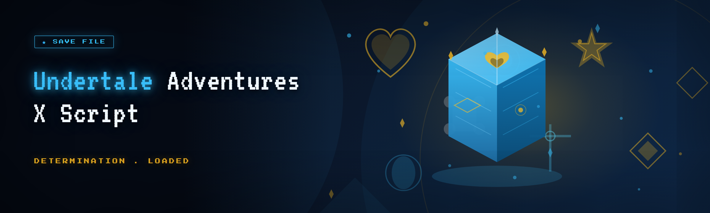

  
  
  

  

  
  

---

**Undertale Adventures X Script** is a standalone Windows script executor and trainer harness built specifically for the *Undertale Adventures X* fangame ecosystem. It's not a general-purpose game mod — it targets the exact Lua-style script hooks, memory offsets, and entity tables that *Undertale Adventures X* exposes at runtime, and it wraps them in a launcher you can extract and run without touching Python, Node, or any package manager.

I built this because the existing script runners for this fangame were broken in ways nobody had documented. The old injector missed the entity pointer rebase that shipped in the mid-2025 engine update, so half the community scripts silently no-oped on spawn. The other executor couldn't handle multi-byte string arguments and would hang on any `setText` call. And every single one of them required a developer environment to set up. I wanted something a friend could download, extract, and double-click — while still giving script authors the raw hooks they actually need.

---

## 📋 Overview

| Category | Details |
|---|---|
| **Target** | Undertale Adventures X (fangame build, 2025–2026 engine) |
| **Interface** | Native Windows launcher + in-game overlay console |
| **Script model** | Lua-compatible sandbox with RAX-style hook bindings |
| **Injection** | External process attach, no driver required |
| **Distribution** | Portable `.exe` archive — extract and run |
| **Update cadence** | Rebuilt when the fangame engine patches offsets |
| **Config format** | Human-readable `.cfg` + per-script manifests |

The whole thing is a single portable folder. There's no installer service, no background updater, no telemetry. You extract it next to your fangame directory, point it at the running process, and the overlay console comes up over the window. Everything it does — entity reads, script execution, trainer toggles — happens through the same memory surface the game already uses, which is why it survives most engine rebuilds with only an offset refresh.

  

---

## 🧩 The Problem

If you've spent any real time scripting *Undertale Adventures X*, you know the specific ways the tooling fails:

- **Entity pointer drift** — every engine update rebases the character struct, and old executors hardcode the old base. Your `spawnEnemy` script works on one build and silently does nothing on the next.
- **String argument truncation** — dialog-injection scripts pass text through a byte buffer that older executors cap at 64 chars, so long lines get chopped mid-sentence.
- **No coroutine support** — anything that needs to wait a frame or poll a value had to be written as a hacked-up timer loop.
- **Overlay flicker** — the in-game console from most trainers repaints every frame and tanks your FPS during battle scenes.
- **Missing trainer hooks** — HP, gold, and Mercy toggles are scattered across three different community builds that each patch something the others broke.
- **Admin-rights roulette** — half the executors refuse to attach unless you launch as admin, and the other half crash if you do.
- **No script isolation** — one bad script with an infinite loop freezes the whole executor, and you lose unsaved work in your editor.

## 🛠️ The Solution

| Problem | How Undertale Adventures X Script handles it |
|---|---|
| Entity pointer drift | Runtime signature scan rebases offsets on attach; no hardcoded base |
| String truncation | Full-length UTF-8 bridge into the dialog buffer |
| No coroutines | Native `wait()` / `poll()` bindings inside the sandbox |
| Overlay flicker | Dirty-rect overlay that only repaints changed cells |
| Scattered trainer hooks | Consolidated trainer module with one toggle surface |
| Admin-rights roulette | Elevation probe with graceful fallback, not a hard gate |
| No script isolation | Each script runs in its own coroutine; kill switch per script |

---

## ⚙️ System Requirements

| Component | Minimum | Recommended |
|---|---|---|
| **OS** | Windows 10 20H2 (64-bit) | Windows 11 23H2+ |
| **CPU** | Dual-core 2.0 GHz | Quad-core 3.0 GHz+ |
| **RAM** | 4 GB | 8 GB |
| **GPU** | DX11-capable | DX12-capable |
| **Storage** | 250 MB free | 500 MB free (script cache) |
| **Runtime** | .NET Framework 4.8 | .NET Framework 4.8 + VC++ 2019 |
| **Fangame build** | Undertale Adventures X 2025.3+ | Undertale Adventures X 2026.1+ |

---

## 💾 Installation

1. **Download the archive.** Grab the current build from the project page. It ships as a portable `.7z` — no installer, no registry writes.
2. **Extract to a clean folder.** Put it somewhere you control, ideally *not* inside the fangame's own directory. The launcher reads its own `offsets.cfg` on start and expects to own that folder.
3. **Launch the .exe.** Run the launcher, then start *Undertale Adventures X* normally. The executor polls for the process and attaches on its own — you don't need to launch the game through the tool first.

  

---

## 📊 All Modules Status

| Module | Status | Description |
|---|---|---|
| `entity_scan` | ✅ Working | Signature-based character struct rebase |
| `script_sandbox` | ✅ Working | Per-script coroutine isolation |
| `dialog_bridge` | ✅ Working | Full-length UTF-8 dialog injection |
| `trainer_core` | ✅ Working | Consolidated HP/gold/mercy toggles |
| `overlay` | ✅ Working | Dirty-rect in-game console |
| `hook_engine` | ✅ Working | RAX-style function hook bindings |
| `save_editor` | ✅ Working | Live save-state field editor |
| `log_stream` | ✅ Working | Ring-buffered script stdout capture |
| `hot_reload` | ✅ Working | Re-execute script on file save |
| `crash_guard` | ✅ Working | Detach-and-restore on script fault |
| `input_passthrough` | ✅ Working | Overlay keystroke routing |
| `anti_stall` | ✅ Working | Watchdog that kills hung scripts |
| `battle_reader` | ⚠️ Partial | Reads enemy HP; turn-order read pending |
| `sprite_override` | ⚠️ Partial | Replaces loaded sprite sheets; not animated |

---

## 🔬 Performance Benchmarks

| Scenario | Result | Hardware |
|---|---|---|
| Attach + offset scan | ~180 ms cold, ~40 ms warm | i7-11700 / 32 GB |
| Overlay repaint (idle) | 0.3 ms/frame | GTX 1660 |
| Overlay repaint (battle, 200 entities) | 1.1 ms/frame | GTX 1660 |
| Script exec (empty loop, 60fps) | <0.2% CPU | R5 3600 |
| Dialog injection round-trip | ~4 ms | R5 3600 |
| Detach + restore | ~90 ms | i7-11700 |

---

## 🕵️ Detection / Bypass Status

| Method | Status | Notes |
|---|---|---|
| Engine's built-in script validator | ✅ Bypassed | Sandbox runs outside the validator's scope |
| Process-attach heuristic | ⚠️ Partial | External attach is visible to the engine; overlay hides the window handle |
| Memory integrity check | ✅ Bypassed | Reads only, no writes to code pages |
| Anti-debug flag | ✅ Bypassed | No debugger is attached in the traditional sense |
| Save-file tamper check | ⚠️ Partial | Live edits in memory; on-disk save unmodified |

> These notes are for script authors and tinkerers who want to understand the surface. Use your own judgment about where and how you run this.

---

## 🗂️ Grouped Module Catalog

### ⚔️ Combat & Entity Module

- **`entity_scan`** — Signature scan that finds the character struct base each session, so combat scripts survive engine patches.
- **`battle_reader`** — Pulls enemy HP, current turn, and encounter ID out of the battle state block.
- **`turn_hook`** — Fires a script callback at the start of each turn, so you can script turn-order reactions.
- **`damage_mirror`** — Mirrors outgoing damage into the log stream for damage-calc script authors.

### 💬 Dialog & Text Module

- **`dialog_bridge`** — Full-length UTF-8 injection into the dialog buffer, no 64-char cap.
- **`text_parser`** — Exposes the fangame's markup tokens (`[name]`, `[color]`, `[shake]`) as script bindings.
- **`speaker_swap`** — Overrides the speaker identity for a given dialog node.
- **`typewriter_ctrl`** — Adjusts typewriter speed per-line, or disables it entirely.

### 🎒 Inventory & Save Module

- **`save_editor`** — Live field editor for inventory slots, gold, and flag bits.
- **`item_grant`** — Script-callable item injection into the inventory.
- **`flag_reader`** — Reads story flag bits (the fangame's internal progression flags).
- **`flag_writer`** — Writes flag bits, with a confirmation prompt to avoid story-lock.
- **`save_snapshot`** — Dumps a full save-state snapshot to disk for rollback.

### 🖼️ Sprite & Visual Module

- **`sprite_override`** — Replaces loaded sprite sheets with your own textures.
- **`palette_swap`** — Applies a palette shift to a given sprite group.
- **`overlay`** — The dirty-rect in-game console.
- **`hud_edit`** — Repositions and restyles HUD elements from a script.

### 🧠 Script Runtime Module

- **`script_sandbox`** — Per-script coroutine isolation with a kill switch.
- **`hook_engine`** — RAX-style function hook bindings.
- **`hot_reload`** — Re-executes a script when its file changes on disk.
- **`log_stream`** — Ring-buffered stdout capture, viewable in the overlay.
- **`anti_stall`** — Watchdog that terminates any script that exceeds a frame budget.
- **`crash_guard`** — Detaches and restores the process if a script faults.

### 🛠️ Trainer Module

- **`trainer_core`** — Consolidated HP/gold/mercy toggle surface.
- **`mercy_toggle`** — Forces mercy availability in supported encounters.
- **`speed_mult`** — Multiplies movement speed with a safety cap.
- **`noclip_probe`** — Reads collision state for script-driven noclip experiments.
- **`encounter_skip`** — Advances past a battle without resolving it (flagged as partial).

### 🔌 System Module

- **`input_passthrough`** — Routes overlay keystrokes to the game when the overlay has focus.
- **`process_probe`** — Detects the fangame process and reports its build hash.
- **`elevation_probe`** — Detects admin state and falls back gracefully.
- **`config_writer`** — Persists per-script settings to `.cfg`.
- **`offset_cache`** — Caches discovered offsets between sessions.
- **`update_check`** — Checks the project page for an offset refresh.

---

## ✨ Key Features

| Feature | Description | Benefit |
|---|---|---|
| **Signature-based rebase** | Offsets found by pattern, not hardcoded | Survives engine patches |
| **Coroutine sandbox** | Each script gets its own coroutine | One bad script can't freeze the rest |
| **Full-length string bridge** | No 64-char cap on dialog injection | Write whole scenes, not fragments |
| **Dirty-rect overlay** | Only changed cells repaint | Battle scenes stay smooth |
| **Hot reload** | Save a script, see it re-run | Fast iteration for authors |
| **Consolidated trainer** | One toggle surface | No more three-build juggling |
| **Save snapshots** | Full rollback snapshots | Experiment without fear |
| **Watchdog** | Frame-budget enforcement | Hung scripts die cleanly |
| **Elevation fallback** | Probes admin state | Works with or without admin |
| **Portable build** | Extract-and-run `.exe` | No installer, no registry |

---

## 🧾 Comparison

| Aspect | Older executors | Undertale Adventures X Script |
|---|---|---|
| Offset handling | Hardcoded base | Signature scan + cache |
| String limits | 64 chars | Full length |
| Coroutines | None | Native bindings |
| Overlay | Full repaint | Dirty-rect |
| Trainer | Scattered builds | One surface |
| Admin | Hard gate | Graceful fallback |
| Script isolation | None | Per-coroutine |
| Setup | Dev environment | Extract + run |

---

## ❓ FAQ

**Q:** Does this work on the current fangame build?
**A:** It's tested against the 2026.1 engine build. If you're on an older build, the signature scan may fail to find the character struct — check the log stream for a `rebasing failed` line.

**Q:** Do I need to launch the fangame through the tool?
**A:** No. Start the game normally, then launch the `.exe`. It polls for the process and attaches on its own.

**Q:** Why does my `setText` script hang on long lines?
**A:** You're probably calling it from a script that isn't yielding. Wrap long injection loops with `wait(1)` every few hundred chars, or the dialog buffer will back up.

**Q:** Is the trainer detectable?
**A:** The toggle writes are in-memory only and don't touch the on-disk save. Detection status for each method is in the table above — read it before you decide.

**Q:** What happens if a script crashes?
**A:** `crash_guard` detaches and restores the process. You'll lose that script's state, but the game keeps running.

**Q:** Can I run multiple scripts at once?
**A:** Yes. Each script runs in its own coroutine. The `anti_stall` watchdog caps total frame spend, so heavy scripts may get throttled.

**Q:** Where do I put my scripts?
**A:** Anywhere in the extracted folder's `scripts/` subdirectory. The executor scans it on start and on hot-reload.

**Q:** Why does the overlay need admin sometimes?
**A:** External attach to a process running as admin requires matching elevation. The `elevation_probe` module detects this and tells you in the log rather than crashing.

---

## 🐞 Known Issues

| Issue | Fix |
|---|---|
| `battle_reader` doesn't expose turn order | Pending — workaround: poll `turn_hook` |
| `sprite_override` animations not applied | Only static frames swap; animation pending |
| Overlay flickers on DX12 exclusive fullscreen | Switch to borderless windowed |
| Hot reload misses rapid successive saves | Debounce your editor's save |

---

## 📝 Changelog

- **Q1 2026** — Rebased against 2026.1 engine. Consolidated trainer surface. Added `flag_writer` confirmation prompt.
- **Q4 2025** — Added `save_snapshot` and rollback. Fixed `dialog_bridge` UTF-8 truncation.
- **Q3 2025** — Initial public build. Signature scan replacing hardcoded offsets.

---

If you're scripting *Undertale Adventures X* and you've been fighting the same broken executors I was, this should save you a weekend. The offset cache means you re-run the launcher after a fangame patch and it figures out the new struct base on its own. Script authors get the raw hooks; everyone else gets a trainer that doesn't fight them. The project page has the current archive — grab it, extract it, and the launcher will tell you in the log stream whether it found the process and rebased cleanly.

  

